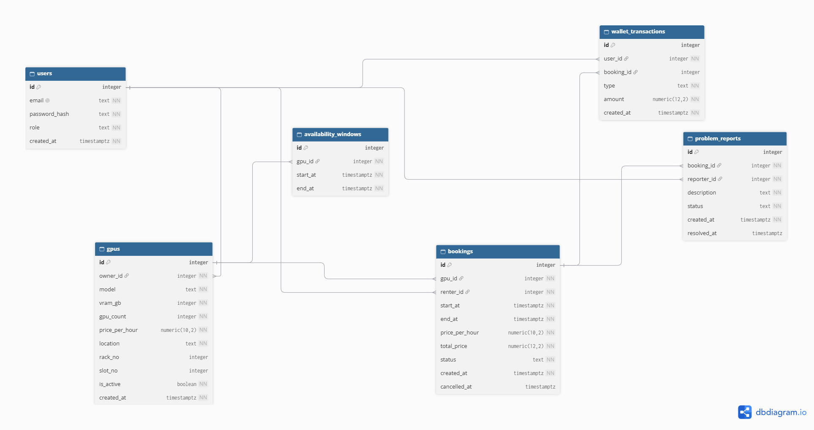

# Rackly Data Model

This document lists every table Rackly stores, its columns, and how the tables connect. The diagram image is added once it is drawn.

## 1. users

| Column | Type | Notes |
|---|---|---|
| id | integer, PK | |
| email | text, unique | used to log in |
| password_hash | text | never the real password |
| role | text | renter, provider or admin |
| created_at | timestamp with time zone | |

## 2. gpus

One row is one rentable unit. A unit can hold several GPUs (for example a server with 8x A100) that are rented together. This keeps booking simple, and it handles the "amount of GPUs" filter through `gpu_count`.

| Column | Type | Notes |
|---|---|---|
| id | integer, PK | |
| owner_id | integer, FK → users.id | the provider |
| model | text | e.g. RTX 4090, A100 |
| vram_gb | integer | memory per GPU |
| gpu_count | integer | GPUs in this unit |
| price_per_hour | numeric(10,2) | |
| location | text | city or region |
| rack_no, slot_no | integer, nullable | where it sits in the 3D room |
| is_active | boolean | provider can switch a listing off; admin can too |
| created_at | timestamp with time zone | |

## 3. availability_windows

The times a provider is willing to rent a GPU out. A GPU can have many windows (for example weekdays only, or a month in the summer).

| Column | Type | Notes |
|---|---|---|
| id | integer, PK | |
| gpu_id | integer, FK → gpus.id | |
| start_at | timestamp with time zone | |
| end_at | timestamp with time zone | must be after start_at |

## 4. bookings

| Column | Type | Notes |
|---|---|---|
| id | integer, PK | |
| gpu_id | integer, FK → gpus.id | what was rented |
| renter_id | integer, FK → users.id | who rented it |
| start_at, end_at | timestamp with time zone | |
| price_per_hour | numeric(10,2) | copied from the GPU at booking time |
| total_price | numeric(12,2) | hours x price, calculated by the backend |
| status | text | confirmed, active, completed, cancelled |
| created_at, cancelled_at | timestamp with time zone | cancelled_at is nullable |

The price is copied into the booking because a provider may change their price later, and old bookings must keep the price the renter agreed to.

## 5. wallet_transactions

| Column | Type | Notes |
|---|---|---|
| id | integer, PK | |
| user_id | integer, FK → users.id | whose wallet |
| booking_id | integer, FK → bookings.id, nullable | null for deposits |
| type | text | deposit, booking_charge, refund, provider_payout |
| amount | numeric(12,2) | signed: money in is positive, money out is negative |
| created_at | timestamp with time zone | |

Balance = the sum of all a user's transactions. Rows are never edited or deleted, only added, which keeps an audit trail. A refund is a new positive row, never a changed old row. If the sum gets slow later, the balance can be cached, but the ledger stays the source of truth.

## 6. problem_reports

| Column | Type | Notes |
|---|---|---|
| id | integer, PK | |
| booking_id | integer, FK → bookings.id | which rental had the problem |
| reporter_id | integer, FK → users.id | the renter |
| description | text | |
| status | text | open or resolved |
| created_at, resolved_at | timestamp with time zone | resolved_at is nullable |

The provider isn't stored here, because it can be found through the booking: booking, then GPU, then `owner_id`. Storing it twice would invite inconsistencies.

## Relationships

The foreign key always lives on the "many" side.

| Relationship | Meaning | Where the FK lives |
|---|---|---|
| users 1 → many gpus | a provider owns many GPUs | gpus.owner_id |
| gpus 1 → many availability_windows | a GPU has many windows | availability_windows.gpu_id |
| gpus 1 → many bookings | a GPU is booked many times (not at once) | bookings.gpu_id |
| users 1 → many bookings | a renter makes many bookings | bookings.renter_id |
| users 1 → many wallet_transactions | a user has many ledger rows | wallet_transactions.user_id |
| bookings 1 → many wallet_transactions | one booking can have a charge, a refund and a payout | wallet_transactions.booking_id |
| bookings 1 → many problem_reports | a booking can have several reports | problem_reports.booking_id |
| users 1 → many problem_reports | a renter files many reports | problem_reports.reporter_id |